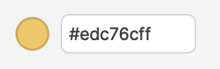
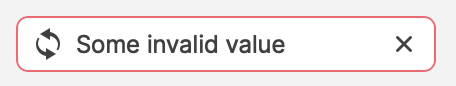
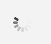
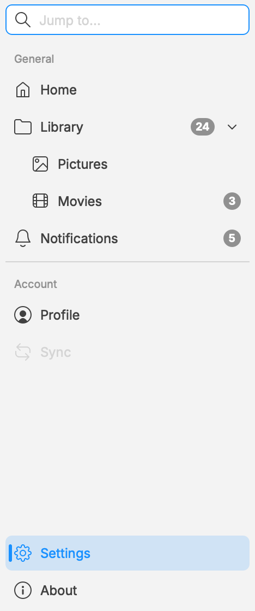
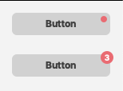
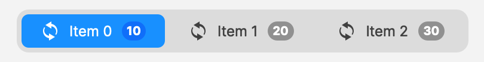
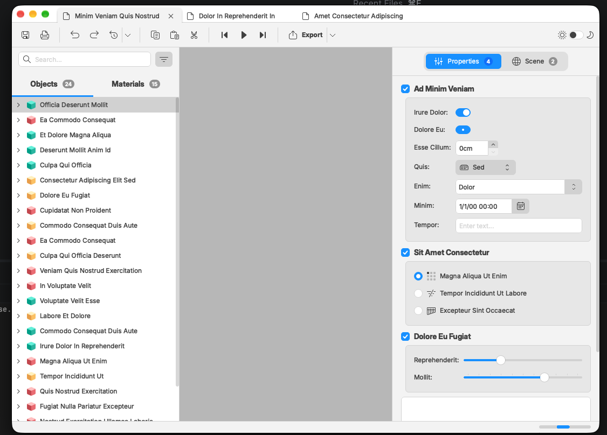

# Widgets

Qlementine provides a collection of `QWidgets` to extend Qt's standard ones.

More information about them coming soon. You can check them in the Sandbox application, at the moment.

## AboutDialog

A standard "About" window that you can use to quickly display basic information about your app.


## AbstractItemListWidget

Base class for [`NavigationBar`](#navigationbar), [`NavigationSidebar`](#navigationsidebar) and [`SegmentedControl`](#segmentedcontrol).

## Action

Improves `QAction` by adding predicates (lambda functions) to update the state.

## ActionButton

Links a `QPushButton` to a `QAction`.

## ColorButton

Allows to pick and display a `QColor`.

## ColorEditor

Displays a `ColorButton` and the color value in an editable `QLineEdit` besides.



## CommandLinkButton

Improves `QCommandLinkButton` by supporting the `icon` property of `QAbstractButton`.


## Expander

Container that allows to hide/show its content with a nice height animation.

## IconWidget

Widget that just shows an icon.

## Label

Improves `QLabel`` by allowing text roles as with HTML (headings h1, etc.).


## LineEdit

Improves `QLineEdit` by allowing statuses to display feedback for user (valid, error, warning, etc.).



## LoadingRing

A modern progress ring that you can use to show that an asynchronous operation is currently running (indeterminate), or to show a progress value (determinate).


## LoadingSpinner

A small widget that you can use to show that an asynchronous operation is currently running.



## Menu

Improves `QMenu` by adding predicates (lambda functions) to update state.

## NavigationBar

A widget that allows to switch between a range of elements, such as seen on Android.


## NavigationSidebar

A vertical sidebar that allows to switch between a range of elements, such as seen in settings windows. It extends [`NavigationBar`](#navigationbar).

- Top items (`addItem`) and bottom items (`addBottomItem`) that stay pinned below the scrollable top items.
- Nested items (`addChildItem`), expanded and collapsed with an animation by clicking the parent, with `setItemExpanded`, or with the Left and Right arrow keys.
- Non-selectable sections (`addSection`) and separators (`addSeparator`, `addBottomSeparator`).
- Icons and badges on every item.
- A scroll bar, displayed when the top items don't fit.
- A header widget and a footer widget (`setHeaderWidget`, `setFooterWidget`) that can contain anything, such as a search field.
- A compact (icon-only) mode (`setCompact`, `toggleCompact`), animated, with tooltips. The header and footer widgets are hidden in compact mode: give the user another way to expand the sidebar again. Nested items are hidden too: clicking their parent opens a flyout menu that contains them, and the parent shows the selection when one of its children is selected.
- `setExpandedWidth` to change the width when not compact.



## NavigationView

A [`NavigationSidebar`](#navigationsidebar) combined with a `QStackedWidget`: selecting an item in the sidebar shows its page. The view takes ownership of the pages.

Use `addPage`, `addBottomPage`, `addChildPage` and `removePage` to manage the pages. Use `sidebar()` to add sections and separators, set the header and footer, or toggle the compact mode. `setAutoCompactWidth` makes the sidebar compact when the view is narrower than the given width.

A complete example is available in the Showcase application: click the "NavigationView" button in the toolbar.

## NotificationBadge

A small badge to display a notification (with or without text) on another widget.

```cpp
// The parent set to the constructor is not important.
auto* badge = new NotificationBadge(someParent);

// The badge's parent will change to theWidget's parent.
badge->setWidget(theWidget);
```



## Popover

A popup-like widget that opens in a separate system window, with a drop shadow and corner radiuses (hence transparency) and an opacity animation when toggling visibility.


## PopoverButton

A button that opens a `Popover` when clicked.

## RoundedFocusFrame

Improves `QFocusFrame` by adding a corner radius property.

## SegmentedControl

A widget that allows to switch between a range of elements, such as seen on iOS or macOS.



## StatusBadgeWidget

Widget to display a status icon: info, warning, error, success. Available in two standard sizes.


## Switch

The famous Switch to toggle between states.


## TitleBar

A themed title bar that is part of the window content. It draws the caption buttons (minimize, maximize, close, menu) when the platform doesn't provide them, hosts an optional content widget (menu bar, search field...) and tells the window which parts of it can be used to drag the window. The content container, plain `QWidget`/`QFrame` containers and display-only widgets (`QLabel`, `QProgressBar`, `QLCDNumber`, `IconWidget`, `StatusBadgeWidget`, `NotificationBadge`) are draggable by default, any other widget placed in the title bar is interactive, unless overridden with `setHitTestVisible()`. `QTabBar`, `QMenuBar`, `QToolBar`, `NavigationBar` and `SegmentedControl` are draggable only in their empty space, not over their tabs, items or child buttons.

## UnifiedWindow

A top-level window whose content extends into the title bar area. It owns a `TitleBar` and a central widget. macOS keeps the traffic lights at the top left, Windows keeps the caption buttons at the top right and supports snap layouts, and Linux draws client-side decorations following the user's button layout.


